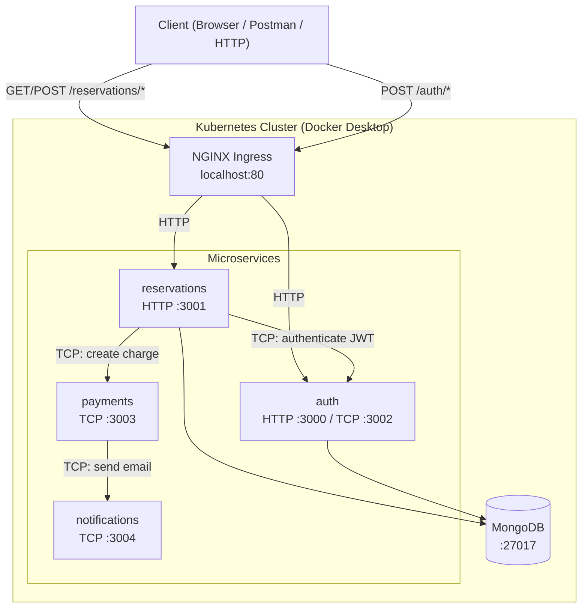
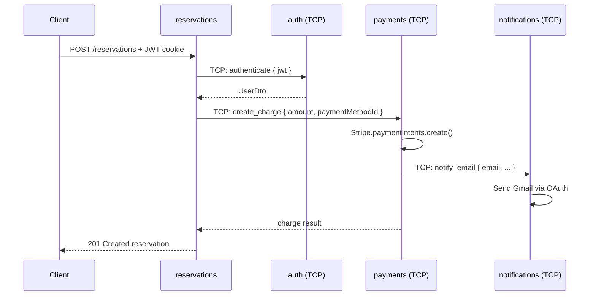

# Sleepr — NestJS Microservices

A hotel reservation platform built with NestJS microservices architecture.

---

## Architecture Overview

The system consists of four independent microservices communicating over TCP, exposed to the outside world through an NGINX Ingress.



---

## Services

| Service | HTTP Port | TCP Port | Responsibility |
|---|---|---|---|
| **reservations** | 3001 | — | CRUD for reservations, JWT-protected routes |
| **auth** | 3000 | 3002 | User registration, login, JWT signing & validation |
| **payments** | — | 3003 | Stripe charge processing |
| **notifications** | — | 3004 | Email notifications via Gmail OAuth |

---

## Inter-Service Communication

Services communicate internally via **TCP transport** (NestJS Microservices). No service is called directly over HTTP from another service.



---

## Shared Library

`libs/common` is a shared library used by all services. It contains:

| Module / File | Purpose |
|---|---|
| `DatabaseModule` | MongoDB connection via Mongoose |
| `AbstractRepository` | Generic repository with CRUD helpers |
| `AbstractSchema` | Base Mongoose schema with `_id` |
| `JwtAuthGuard` | Reusable JWT guard (delegates to auth via TCP) |
| `CurrentUser` decorator | Extracts user from request |
| `LoggerModule` | Pino structured logger |
| DTOs: `UserDto`, `CardDto`, `CreateChargeDto` | Shared data shapes |

---

## Tech Stack

| Layer | Technology |
|---|---|
| Framework | NestJS 11 |
| Language | TypeScript 5 |
| Database | MongoDB + Mongoose |
| Auth | Passport.js, JWT, bcryptjs |
| Payments | Stripe |
| Email | Nodemailer + Google OAuth2 |
| Package Manager | pnpm (workspace) |
| Containerization | Docker (multi-stage builds) |
| Orchestration | Kubernetes + Helm |
| Ingress | NGINX Ingress Controller |

---

## Local Development (Docker Compose)

```bash
docker-compose up
```

Services and ports:

| Service | URL |
|---|---|
| reservations | http://localhost:3001 |
| auth | http://localhost:3000 |
| MongoDB | mongodb://localhost:27017 |

---

## Kubernetes Deployment (Docker Desktop)

### Prerequisites

```bash
# Install NGINX Ingress Controller (one-time)
kubectl apply -f https://raw.githubusercontent.com/kubernetes/ingress-nginx/controller-v1.12.0/deploy/static/provider/cloud/deploy.yaml
```

### Build images

```bash
docker build -t auth:latest -f apps/auth/Dockerfile --target production .
docker build -t reservations:latest -f apps/reservations/Dockerfile --target production .
docker build -t payments:latest -f apps/payments/Dockerfile --target production .
docker build -t notifications:latest -f apps/notifications/Dockerfile --target production .
```

### Deploy

```bash
cd k8s/sleepr
helm install sleepr .
```

### Access

| Endpoint | URL |
|---|---|
| Reservations API | http://localhost/reservations |
| Auth API | http://localhost/auth |

For full command reference see [docs/KUBERNETES_COMMANDS.md](docs/KUBERNETES_COMMANDS.md).

---

## Project Structure

```
sleepr/
├── apps/
│   ├── auth/             # Auth microservice
│   ├── reservations/     # Reservations microservice
│   ├── payments/         # Payments microservice
│   └── notifications/    # Notifications microservice
├── libs/
│   └── common/           # Shared modules, DTOs, guards
├── k8s/
│   └── sleepr/           # Helm chart
│       └── templates/
│           ├── auth/
│           ├── reservations/
│           ├── payments/
│           ├── notifications/
│           └── ingress.yaml
├── docs/
│   ├── ARCHITECTURE.md
│   ├── AUTH_FLOW.md
│   └── KUBERNETES_COMMANDS.md
├── docker-compose.yml
└── pnpm-workspace.yaml
```

---

## Documentation

| File | Description |
|---|---|
| [docs/ARCHITECTURE.md](docs/ARCHITECTURE.md) | Detailed architecture, guards, strategies |
| [docs/AUTH_FLOW.md](docs/AUTH_FLOW.md) | Step-by-step auth flow with diagrams |
| [docs/KUBERNETES_COMMANDS.md](docs/KUBERNETES_COMMANDS.md) | All Docker, Helm, kubectl commands |
