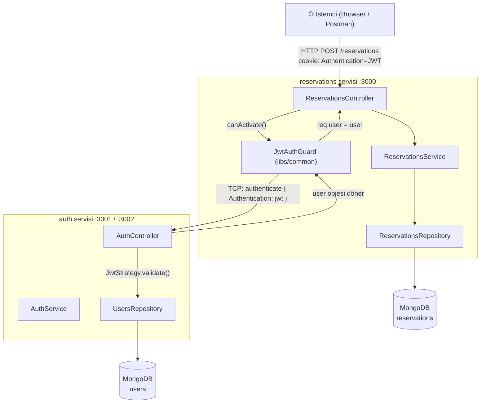
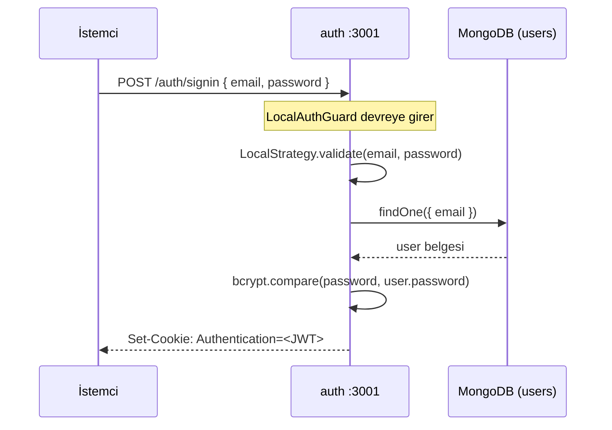
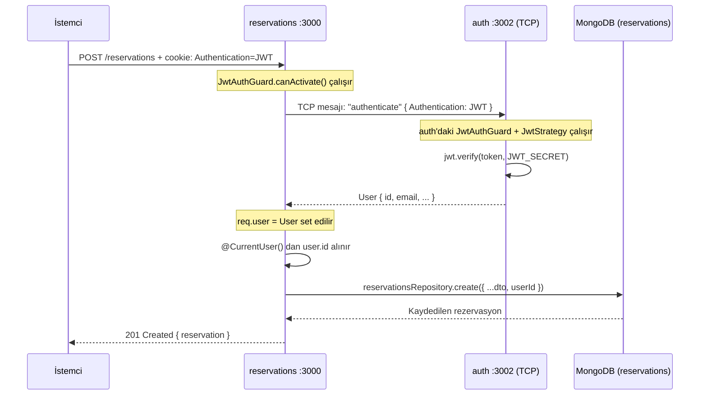
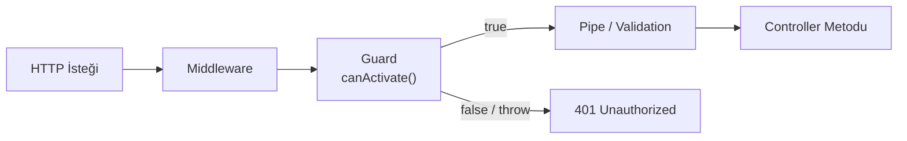
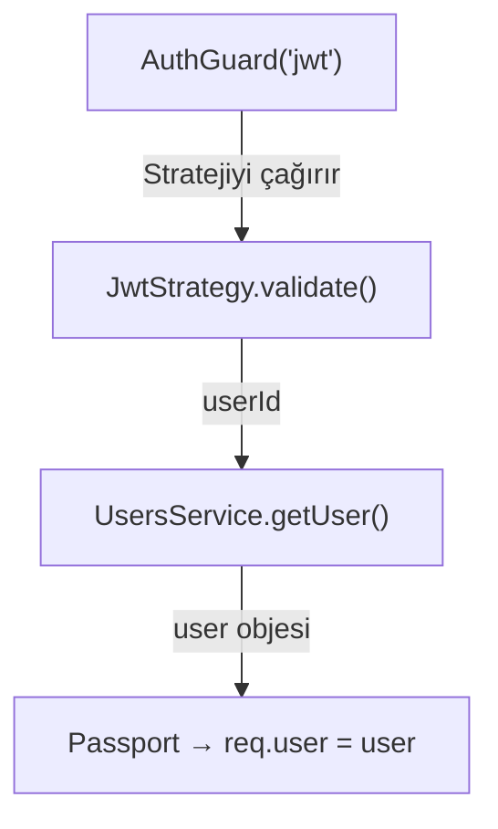
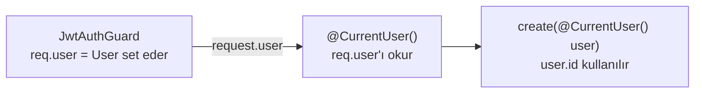
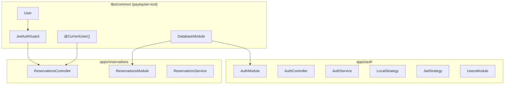

# Sleepr — Microservices Mimarisi

> NestJS'e yeni başlayanlar için adım adım açıklama.

---

## 1. Genel Bakış — Servisler Nasıl Haberleşiyor?

Bu projede **iki ayrı NestJS uygulaması** birbirinden bağımsız çalışır:

| Servis | Port (HTTP) | Port (TCP) | Görev |
|---|---|---|---|
| **auth** | 3001 | 3002 | Kullanıcı kaydı, giriş, JWT üretimi ve doğrulaması |
| **reservations** | 3000 | — | Rezervasyon CRUD işlemleri |



> **Önemli:** `reservations` servisi JWT'yi **kendisi doğrulamaz**. TCP üzerinden `auth` servisine sorar. Bu sayede secret key yalnızca `auth` servisinde bulunur.

---

## 2. Login Akışı — Adım Adım



1. İstemci email + password gönderir.
2. `LocalAuthGuard` → `LocalStrategy.validate()` çağırır.
3. Strateji şifreyi bcrypt ile doğrular.
4. `AuthService.signIn()` bir JWT imzalar ve cookie olarak tarayıcıya gönderir.

---

## 3. Rezervasyon Oluşturma — Adım Adım



---

## 4. Guard Nedir? Nasıl Çalışır?

Guard, bir HTTP isteği **controller metoduna ulaşmadan önce** çalışan bir kapıcıdır.



```typescript
// Kullanımı — dekoratör olarak eklenir
@UseGuards(JwtAuthGuard)
@Post()
async create(@Body() dto: CreateReservationDto) { ... }
```

### Bu Projedeki Guard'lar

| Guard | Nerede? | Ne Yapar? |
|---|---|---|
| `LocalAuthGuard` | auth servisi | email/password doğrular (sadece `/signin`) |
| `JwtAuthGuard` (auth içi) | auth servisi | Passport ile JWT doğrular, `authenticate` endpoint'ini korur |
| `JwtAuthGuard` (libs/common) | reservations servisi | Cookie'deki JWT'yi auth servisine TCP ile sorar |

### libs/common JwtAuthGuard — Detay

```typescript
canActivate(context: ExecutionContext): Observable<boolean> {
  // 1. Cookie'den JWT'yi al
  const jwt = request.cookies?.Authentication;
  if (!jwt) return false;                        // JWT yoksa → 401

  // 2. auth servisine TCP mesajı gönder
  return this.authClient.send('authenticate', { Authentication: jwt }).pipe(
    tap(user => request.user = user),            // 3. user'ı request'e ekle
    map(() => true),                             // 4. guard'ı geçir
    catchError(() => throwError(                 // 5. hata gelirse → 401
      () => new UnauthorizedException()
    ))
  );
}
```

---

## 5. Strateji (Strategy) Nedir?

Strategy, "kimlik doğrulamanın **nasıl yapıldığını**" tanımlar. Guard sadece "çalıştır" der, strateji "nasıl çalıştırılır" bilir.



| Strateji | Tetikleyici | Doğrulama Yöntemi |
|---|---|---|
| `LocalStrategy` | `AuthGuard('local')` | email + password → bcrypt |
| `JwtStrategy` | `AuthGuard('jwt')` | Cookie'deki token → jwt.verify |

---

## 6. @CurrentUser() Dekoratörü Nedir?

`@CurrentUser()` bir **param dekoratörüdür**. Controller metodunun parametresine otomatik olarak `req.user` nesnesini enjekte eder.

```typescript
// Dekoratörün tanımı (libs/common)
export const CurrentUser = createParamDecorator(
  (_data, context: ExecutionContext) =>
    context.switchToHttp().getRequest().user   // sadece req.user'ı döndürür
);
```



```typescript
// Kullanımı
@Post()
async create(
  @Body() dto: CreateReservationDto,
  @CurrentUser() user: User     // ← Guard'ın set ettiği req.user gelir
) {
  return this.service.create(dto, user.id);
}
```

> **Guard + @CurrentUser() birlikte çalışır:**
> Guard `req.user`'ı set eder → `@CurrentUser()` o değeri okur.
> Guard olmadan `@CurrentUser()` her zaman `undefined` döner.

---

## 7. Proje Katmanları Özeti



---

## 8. Akış Özeti — Tek Cümleyle

```
İstemci → [JWT cookie] → reservations guard → [TCP] → auth doğrular
       → user bilgisi döner → @CurrentUser() ile alınır → rezervasyon kaydedilir
```
