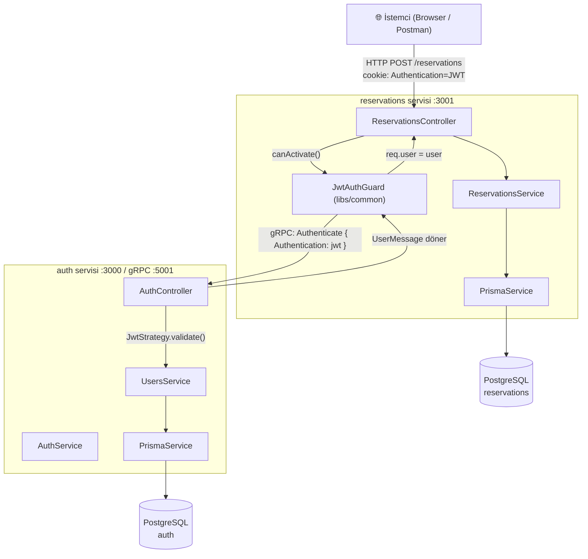
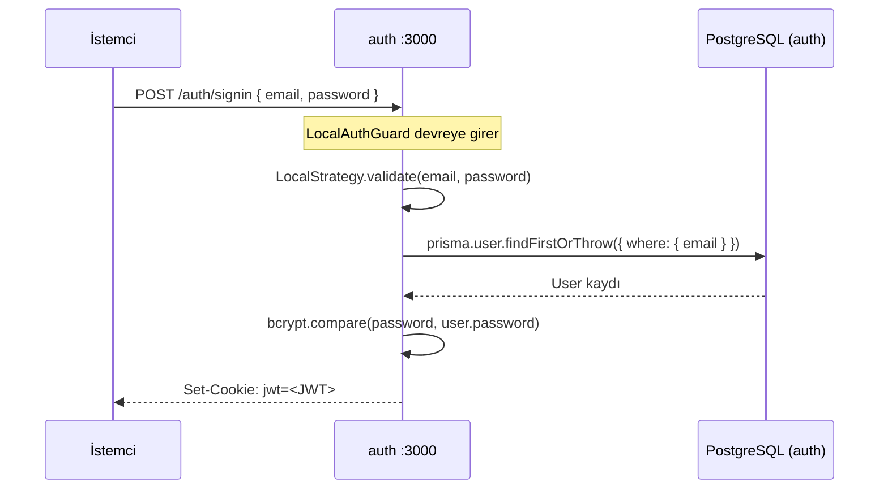
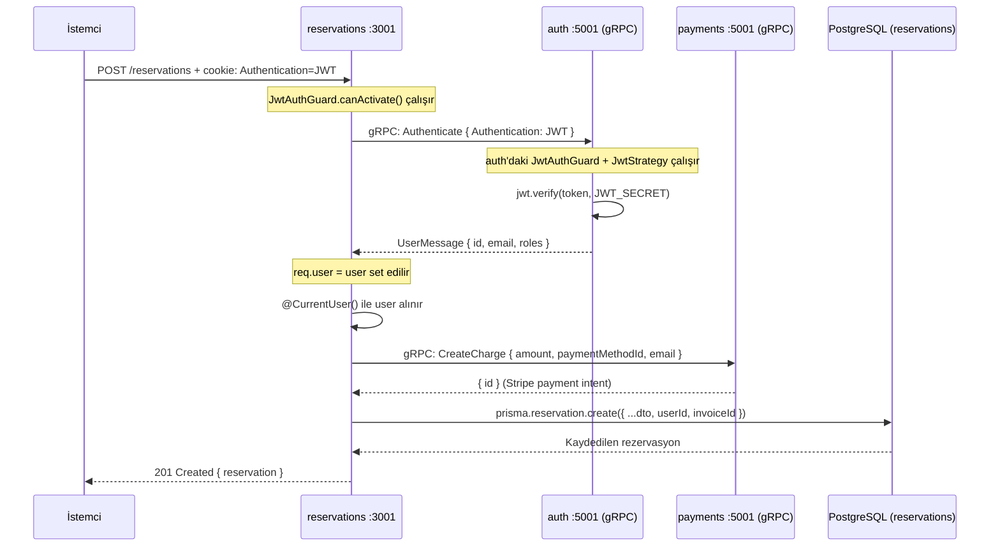
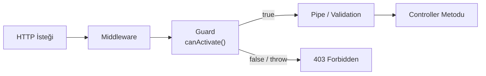
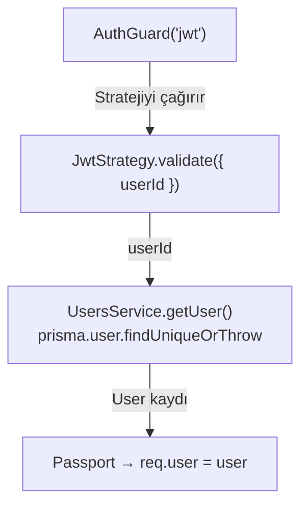
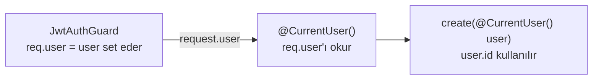
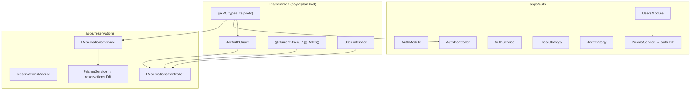

# Sleepr — Microservices Mimarisi

> NestJS'e yeni başlayanlar için adım adım açıklama.

---

## 1. Genel Bakış — Servisler Nasıl Haberleşiyor?

Bu dokümanda kimlik doğrulama akışının geçtiği **iki NestJS uygulaması** anlatılıyor (payments ve notifications için [README](../README.md)'ye bakın):

| Servis | Port (HTTP) | gRPC | Veritabanı | Görev |
|---|---|---|---|---|
| **auth** | 3000 | `auth:5001` | PostgreSQL `auth` | Kullanıcı kaydı, giriş, JWT üretimi ve doğrulaması |
| **reservations** | 3001 | sadece client | PostgreSQL `reservations` | Rezervasyon CRUD işlemleri |

Veritabanı erişimi **Prisma** ile yapılır. Her serviste `PrismaService` (`src/prisma.service.ts`) bulunur. Bu servis `PrismaClient`'ı genişletir ve `@prisma/adapter-pg` ile `DATABASE_URL`'e bağlanır.



> **Önemli:** `reservations` servisi JWT'yi **kendisi doğrulamaz**. gRPC üzerinden `auth` servisine sorar. Bu sayede secret key yalnızca `auth` servisinde bulunur.

---

## 2. Login Akışı — Adım Adım



1. İstemci email + password gönderir.
2. `LocalAuthGuard` → `LocalStrategy.validate()` çağırır.
3. Strateji şifreyi bcrypt ile doğrular.
4. `AuthService.signIn()` `{ userId: user.id }` içeren bir JWT imzalar ve cookie olarak tarayıcıya gönderir.

> ⚠️ **Bilinen uyumsuzluk:** `AuthService` token'ı `jwt` adlı cookie'ye yazıyor, ama `JwtAuthGuard` (libs/common) ve `JwtStrategy` token'ı `Authentication` cookie'sinden okuyor. İsimler eşitlenene kadar korumalı istekler 401/403 döner.

---

## 3. Rezervasyon Oluşturma — Adım Adım



---

## 4. Guard Nedir? Nasıl Çalışır?

Guard, bir HTTP isteği **controller metoduna ulaşmadan önce** çalışan bir kapıcıdır.



```typescript
// Kullanımı — dekoratör olarak eklenir
@UseGuards(JwtAuthGuard)
@Post()
async create(@Body() dto: CreateReservationDto) { ... }
```

### Bu Projedeki Guard'lar

| Guard | Nerede? | Ne Yapar? |
|---|---|---|
| `LocalAuthGuard` | auth servisi | email/password doğrular (sadece `/signin`) |
| `JwtAuthGuard` (auth içi) | auth servisi | Passport ile JWT doğrular, gRPC `Authenticate` metodunu korur |
| `JwtAuthGuard` (libs/common) | reservations servisi | Cookie'deki JWT'yi auth servisine gRPC ile sorar, `@Roles()` kontrolü yapar |

### libs/common JwtAuthGuard — Detay

```typescript
onModuleInit() {
  // gRPC client'ından AuthService stub'ını al
  this.authService = this.client.getService<AuthServiceClient>(AUTH_SERVICE_NAME);
}

canActivate(context: ExecutionContext): Observable<boolean> {
  // 1. Cookie'den JWT'yi al
  const jwt = context.switchToHttp().getRequest().cookies?.Authentication;
  if (!jwt) return false;                          // JWT yoksa → 403

  // 2. Route'un istediği rolleri oku (@Roles('admin'))
  const requiredRoles = this.reflector.get<string[]>('roles', context.getHandler());

  // 3. auth servisine gRPC çağrısı yap
  return this.authService.authenticate({ Authentication: jwt }).pipe(
    tap(res => {
      // 4. Rol eksikse hata fırlat
      for (const role of requiredRoles || []) {
        if (!res.roles?.includes(role)) throw new UnauthorizedException();
      }
      // 5. user'ı request'e ekle
      context.switchToHttp().getRequest().user = { ...res, _id: res.id };
    }),
    map(() => true),
    catchError(() => of(false)),                   // 6. hata gelirse → 403
  );
}
```

> Guard hata durumunda exception yerine `false` döndürdüğü için NestJS **403 Forbidden** cevabı verir.

---

## 5. Strateji (Strategy) Nedir?

Strategy, "kimlik doğrulamanın **nasıl yapıldığını**" tanımlar. Guard sadece "çalıştır" der, strateji "nasıl çalıştırılır" bilir.



| Strateji | Tetikleyici | Doğrulama Yöntemi |
|---|---|---|
| `LocalStrategy` | `AuthGuard('local')` | email + password → bcrypt |
| `JwtStrategy` | `AuthGuard('jwt')` | Cookie / gRPC mesajındaki token → jwt.verify |

---

## 6. @CurrentUser() Dekoratörü Nedir?

`@CurrentUser()` bir **param dekoratörüdür**. Controller metodunun parametresine otomatik olarak `req.user` nesnesini enjekte eder.

```typescript
// Dekoratörün tanımı (libs/common)
export const CurrentUser = createParamDecorator(
  (_data, context: ExecutionContext) =>
    context.switchToHttp().getRequest().user   // sadece req.user'ı döndürür
);
```



```typescript
// Kullanımı
@Post()
@UseGuards(JwtAuthGuard)
async create(
  @Body() dto: CreateReservationDto,
  @CurrentUser() user: User     // ← Guard'ın set ettiği req.user gelir
) {
  return this.reservationsService.create(dto, user);
}
```

> **Guard + @CurrentUser() birlikte çalışır:**
> Guard `req.user`'ı set eder → `@CurrentUser()` o değeri okur.
> Guard olmadan `@CurrentUser()` her zaman `undefined` döner.

> `User` arayüzü `libs/common/src/interfaces` içindedir. `id` alanı Prisma'daki `Int` id'ye karşılık gelir. gRPC mesajında (`UserMessage`) `string` olarak taşındığı için servislerde `+userId` ile sayıya çevrilir.

---

## 7. Proje Katmanları Özeti



---

## 8. Akış Özeti — Tek Cümleyle

```
İstemci → [JWT cookie] → reservations guard → [gRPC] → auth doğrular
       → user bilgisi döner → @CurrentUser() ile alınır
       → [gRPC] payments ödeme alır → Prisma ile rezervasyon kaydedilir
```
