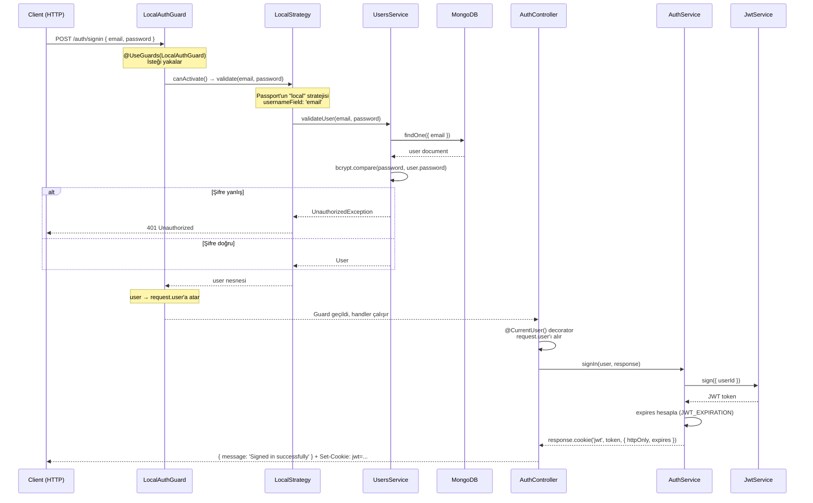
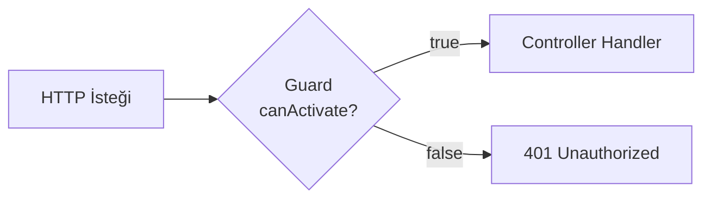
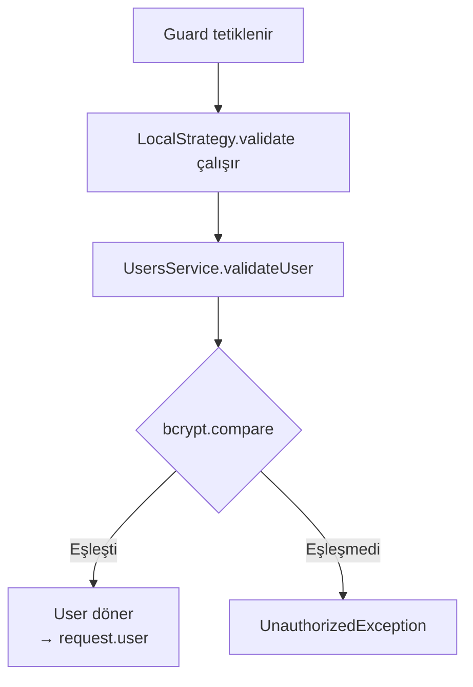
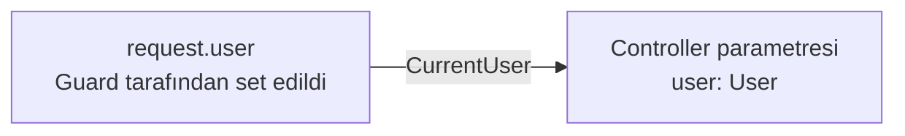
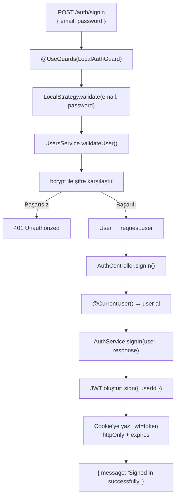
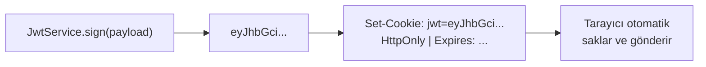
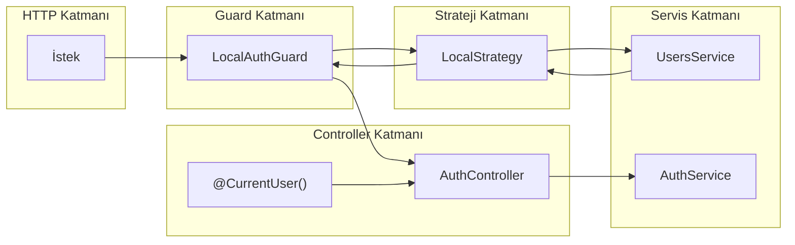

# Auth Akışı — SignIn Nasıl Çalışır?

## Genel Akış Diyagramı



---

## Kavramlar

### 1. Guard Nedir?

Guard, bir route handler çalışmadan **önce** devreye giren bir kapı bekçisidir.  
`canActivate()` metodu `true` dönerse istek geçer, `false`/exception dönerse **401 Unauthorized** fırlatılır.



```typescript
// local-auth.guard.ts
export class LocalAuthGuard extends AuthGuard('local') {}
```

`AuthGuard('local')` → Passport'un `local` stratejisini tetikler.  
`@UseGuards(LocalAuthGuard)` → Bu decorator ile controller metoduna bağlanır.

---

### 2. Strategy (Strateji) Nedir?

Strategy, kimlik doğrulama **mantığının** yazıldığı yerdir.  
Passport.js'in sağladığı bir yapıdır. Her strateji farklı bir doğrulama yöntemi uygular:

| Strateji | Açıklama |
|---|---|
| `local` | Email + şifre ile doğrulama |
| `jwt` | JWT token ile doğrulama |
| `google` | Google OAuth ile doğrulama |

```typescript
// local.strategy.ts
@Injectable()
export class LocalStrategy extends PassportStrategy(Strategy) {
  constructor(private readonly usersService: UsersService) {
    super({ usernameField: 'email' }); // default 'username' yerine 'email' kullan
  }

  async validate(email: string, password: string) {
    // dönen değer → request.user'a atanır
    return await this.usersService.validateUser(email, password);
  }
}
```



---

### 3. Decorator Nedir?

Decorator, bir sınıfa, metoda veya parametreye **metadata ekleyen** ya da davranışını değiştiren özel bir fonksiyondur.

#### `@CurrentUser()` — Custom Param Decorator

```typescript
// current-user.decorator.ts
export const CurrentUser = createParamDecorator(
  (_data: unknown, context: ExecutionContext) =>
    context.switchToHttp().getRequest().user  // request.user'ı döndür
);
```



Guard → Strategy → `request.user = userDoc` → `@CurrentUser()` bunu alır.

---

### 4. SignIn Tam Akışı (Özet)



---

### 5. Cookie'de JWT



- `httpOnly: true` → JavaScript ile okunamaz (XSS koruması)
- `expires` → `JWT_EXPIRATION` saniye sonra geçersiz olur

---

### Mimari Özet


